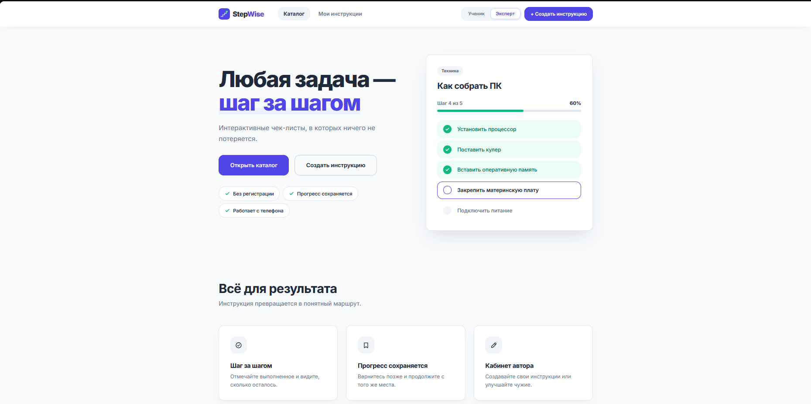
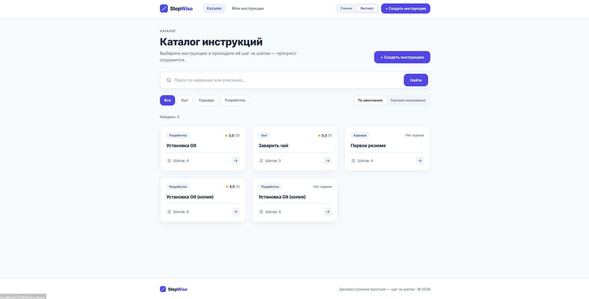
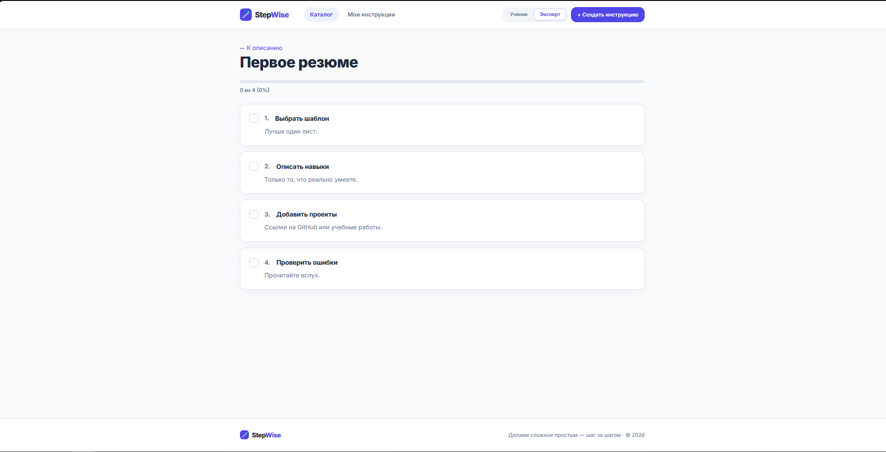
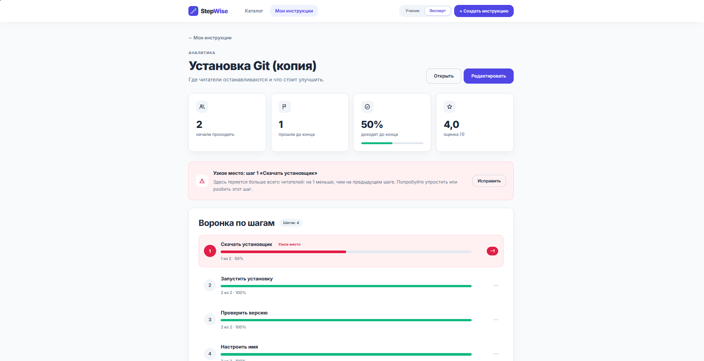

# StepWise

**Платформа интерактивных пошаговых инструкций с чек-листами.**
Любая сложная задача разбивается на шаги: их можно проходить, отмечать выполненное и видеть прогресс. Авторы создают и улучшают инструкции, а по данным прохождения находят «узкие места», на которых люди бросают инструкцию.

Проект выполнен в рамках хакатона TASKILLS, трек «Веб-разработка» (тема «Интерактивные инструкции с чек-листами»).








## Возможности

### Обязательные
- **Каталог инструкций:** карточки с категорией, числом шагов и оценкой.
- **Прохождение:** шаги с отметками выполнения и прогресс-баром, процент считается автоматически.
- **Кабинет автора:** создание, редактирование и удаление инструкций, форма с проверкой ввода.
- **Сохранение и восстановление прогресса:** при повторном заходе отметки на месте.

### Дополнительные
- **Оценки полезности и рейтинг:** оценка 1–5, средняя оценка в карточках, сортировка «Сначала популярные».
- **Поиск и категории:** поиск по названию, описанию и категории без учёта регистра, фильтр по категориям.
- **Форк инструкций:** эксперт создаёт свою копию чужой инструкции, улучшает её, а на странице копии видно, на чём она основана.
- **Аналитика для авторов:** сколько человек начали и прошли инструкцию, на каком шаге чаще всего останавливаются («узкое место»).
- **Роли эксперта и ученика:** ученик проходит и оценивает, эксперт создаёт, улучшает и смотрит аналитику (демонстрационная реализация, см. «Ограничения»).
- **Мобильная версия:** адаптивная вёрстка всех страниц.
- **Печать и экспорт в PDF:** страница инструкции печатается без лишних элементов, сохранить в PDF можно через диалог печати браузера.

## Технологии

| Часть | Что используется |
|---|---|
| Язык и платформа | C#, .NET 10, ASP.NET Core MVC |
| Страницы | Razor Views, HTML, CSS (собственная дизайн-система), JavaScript |
| База данных | SQLite через Entity Framework Core (миграции) |
| Версии кода | Git и GitHub, работа через ветки и Pull Request |

## Быстрый старт

### Что нужно
- .NET 10 SDK
- Visual Studio 2026 с нагрузкой «ASP.NET и веб-разработка» (либо только консоль, см. ниже)

### Запуск в Visual Studio
1. Скачайте репозиторий:
```
git clone https://github.com/SpartaTM/StepWise.git
```
2. Откройте файл `StepWise.sln`.
3. Нажмите **F5**. Сайт откроется в браузере.

### Запуск из консоли
```
cd StepWise
dotnet run --project StepWise
```
Адрес сайта будет выведен в консоли (строка `Now listening on: ...`).

### База данных
Ничего настраивать не нужно. При первом запуске приложение само создаёт файл `stepwise.db` (SQLite), применяет миграции и добавляет три тестовые инструкции. Чтобы вернуть базу к исходному состоянию, остановите приложение и удалите файлы `stepwise.db`, `stepwise.db-shm` и `stepwise.db-wal` в папке проекта.

## Архитектура

```
StepWise/                      ← корень репозитория
├── StepWise.sln
├── README.md
└── StepWise/                  ← проект ASP.NET Core MVC
    ├── Controllers/           Home, Instructions, Player, Author, Account
    ├── Models/                Instruction, Step, Progress, ProgressStep, Rating
    ├── ViewModels/            данные, которые нужны конкретным страницам
    ├── Services/              CurrentUser — идентификатор пользователя и роль
    ├── Filters/               ExpertOnly — доступ только в режиме эксперта
    ├── Data/                  AppDbContext, SeedData (тестовые данные)
    ├── Migrations/            миграции базы данных
    ├── Views/                 Razor-страницы
    └── wwwroot/               css, js, изображения
```

### Модель данных

| Сущность | Назначение |
|---|---|
| `Instruction` | Инструкция: название, описание, категория, автор, дата, ссылка на оригинал при форке |
| `Step` | Шаг инструкции с порядковым номером |
| `Progress` | Прохождение инструкции одним пользователем (одно на пару «пользователь — инструкция») |
| `ProgressStep` | Отметка о выполнении конкретного шага в прохождении |
| `Rating` | Оценка 1–5, одна на пару «пользователь — инструкция» |
|---|---|

Процент прогресса не хранится в базе, а считается как «отмеченные шаги / все шаги инструкции», поэтому не может разойтись с отметками. Отметки шагов отправляются на сервер без перезагрузки страницы (JavaScript `fetch`), прогресс-бар обновляется ответом сервера.

### Пользователи
Регистрации нет: при первом заходе сайт кладёт в браузер cookie `stepwise_uid` со случайным идентификатором. По нему определяются кабинет автора и прогресс. Роль (ученик или эксперт) хранится в cookie `stepwise_role`.

## Ограничения и планы

- **Нет авторизации.** Пользователь определяется cookie, поэтому в другом браузере или после очистки данных сайта это будет новый пользователь с новым кабинетом и прогрессом.
- **Роли демонстрационные.** Режим эксперта выбирается самим пользователем, это разделение интерфейса, а не защита. В планах: ASP.NET Identity, подтверждение экспертов.

## Команда

| Участник | Роль | Что сделал |
|---|---|---|
| Данила Прохоров | Team Lead, C# | Архитектура, модели и БД, каталог, кабинет автора, оценки, форк, аналитика, роли, интеграция и GitHub |
| Степан Краснов | C# | Прохождение инструкций, отметки и сохранение прогресса, поиск, тестирование |
| Милана Григорян | Frontend, дизайн | Дизайн-система, макеты, вёрстка, адаптив, печатная версия |
